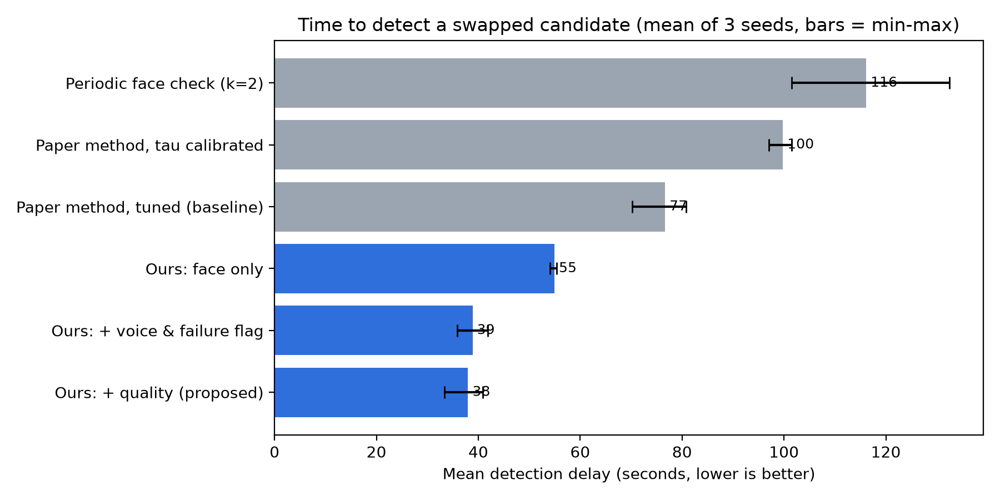
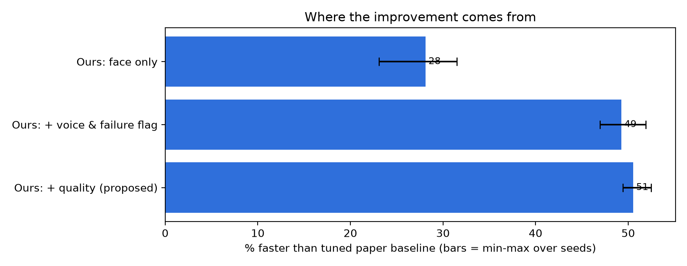

# Swapdetect

**Catching a swapped candidate faster during online interviews and exams.**

Login-only face checks verify a person once. Swapdetect keeps checking during the session, using face and voice evidence, and raises an alarm when the person at the keyboard changes. This repository contains the code, final results, figures, and a full write-up of how it compares to a reimplementation of a 2026 published method.

> **Status:** research prototype, evaluated on simulated webcam degradation with acted studio data. Not tested on real exams, real webcams, or attackers. See [Limitations](docs/LIMITATIONS.md).

## Headline result

Against a reimplementation of the temporal-decay authenticator of Palmetshofer et al. (2026), tuned on calibration people, our method detected swaps **about 50% faster** (mean 50.5%, range 49.4% to 52.5% over 3 seeds) at comparable false-alarm rates (0.169 vs 0.145 per hour), on 91 people.

| Method | Delay (s) | False alarms / h | Swaps missed |
|---|---|---|---|
| Login-only (existing) | never detects | 0 | 100% |
| Periodic face check (k=2) | 116.1 | 0.091 | 8.2% |
| Paper method, threshold calibrated | 99.8 | 0.154 | 0.5% |
| **Paper method, tuned (baseline)** | **76.7** | **0.145** | **0.8%** |
| Ours: face only | 54.9 | 0.190 | 0% |
| Ours: + voice and failure flag | 38.9 | 0.199 | 0% |
| **Ours: + quality (proposed)** | **38.0** | **0.169** | **0%** |

Mean of 3 seeds, 91 people, 5-fold cross-validation with every person tested once. Delay is measured on swaps that were detected.




**What this does not show:** the continuous quality score is *not* shown to help (its effect on delay flips sign across seeds: +2.2 s, +2.5 s, -2.0 s). Most of the gain comes from fusing voice and using the face-found flag, which were tested together. The metric is detection delay at similar false alarms, not recognition accuracy.

## How it works

Three changes relative to the reference paper's authenticator:

1. **Decision rule:** a CUSUM change detector calibrated to a false-alarm target, instead of decaying trust with a fixed threshold.
2. **Evidence:** learned fusion of face and voice, instead of face only.
3. **Failure handling:** a face-found flag, so a missing face counts as missing evidence rather than as an impostor.

Details: [docs/METHOD.md](docs/METHOD.md). The reference paper and what we took from it: [docs/REFERENCE_PAPER.md](docs/REFERENCE_PAPER.md).

## Repository layout

```
swapdetect/
├── README.md
├── docs/
│   ├── METHOD.md            what we built and the three changes
│   ├── REFERENCE_PAPER.md   the paper, what we reimplemented, what we did not
│   ├── EXPERIMENT.md        data, protocol, metrics, fairness safeguards
│   ├── LIMITATIONS.md       what we do not claim
│   ├── FAQ.md               questions a reviewer is likely to ask
│   ├── TODO_BEFORE_PUBLISHING.md
│   └── index.html           project website (enable GitHub Pages on /docs)
├── results_final/
│   ├── results.json         every number used in the docs and website
│   └── figures/             charts made by make_results.py
├── make_results.py          builds figures and results.json from the CSVs
├── detectors.py             detectors incl. the paper reimplementation
├── fusion.py                face and voice evidence fusion
├── simulator.py             session simulation constants and helpers
├── evaluate.py              detection-time and bootstrap helpers
├── evaluate_real.py         evaluation on the real-actor features
├── evaluate_cv.py           5-fold cross-validated evaluation
├── summarize_seeds.py       summary over seeds
├── test_detectors.py        unit tests
├── test_real_pipeline.py    pipeline tests
├── requirements.txt
└── data/                    not committed (see Data)
```

The `.py` files other than `make_results.py` come from the original project folder and must be copied in (see the TODO file).

## Quick start

```bash
python3.11 -m venv .venv311 && source .venv311/bin/activate
pip install -r requirements.txt

python test_detectors.py
python -W ignore test_real_pipeline.py
```

## Reproduce the results

```bash
for s in 0 1 2; do
  python -W ignore evaluate_cv.py --folds 5 \
    --cache ~/swapdetect_data/features_cache_heavy \
    --target_fa_per_hour 0.1 --p_deg 0.5 --seed $s --tag s$s > cv_s$s.txt 2>&1
done
python summarize_seeds.py
python make_results.py
```

Each run takes a long time because the baseline's settings are tuned inside every fold. The baseline tuning grid is set at the top of `evaluate_cv.py` (k_weight 5 to 90 s, k_decay 60 to 6000 s).

## Fairness of the comparison

- Same face embeddings and same people for our method and the reimplemented baseline.
- All thresholds, fusion weights and baseline settings are fitted only on calibration people, never on the person being tested.
- The baseline is tuned, not used with the paper's untuned settings. The paper's published threshold gives about 17 false alarms per hour on our data, so that row is shown but not used for any claim.
- The tuning grid was widened twice until the improvement stopped changing.
- Three seeds, with ranges and bootstrap confidence intervals.

## Data

The raw recordings and feature caches are not included. Dataset: **TODO: name, source and licence of the 91-actor dataset.** Put the files under `data/` or point `--cache` at your feature cache.

## Reference

Palmetshofer, Findling, Kurz. *Continuous Face Authentication on Mobile and Desktop Platforms: A Comparative Study.* arXiv 2608.00763.

This project reimplements the paper's equations on our own features. It does not use the authors' data and does not reproduce their published numbers.

## License

MIT, see [LICENSE](LICENSE).
